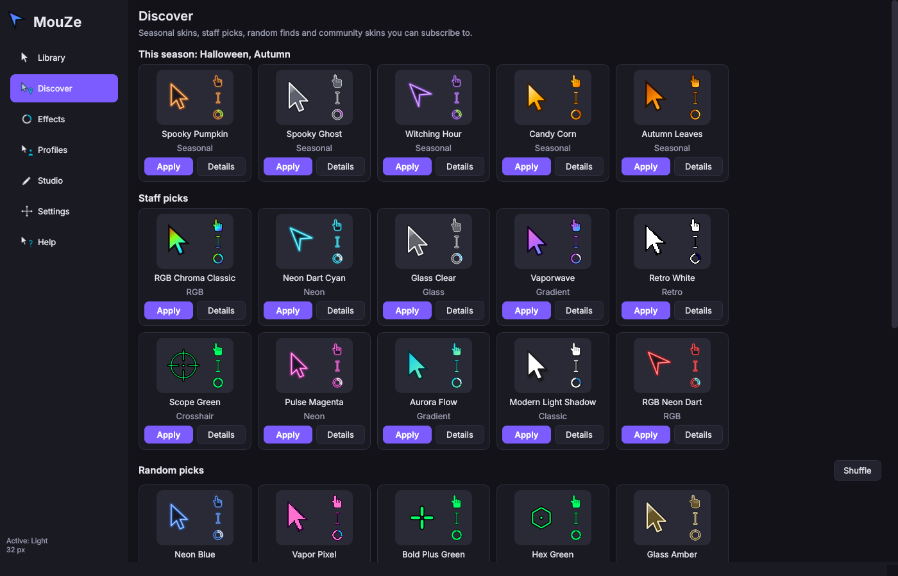
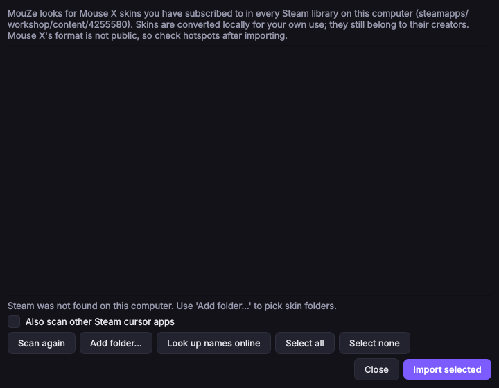
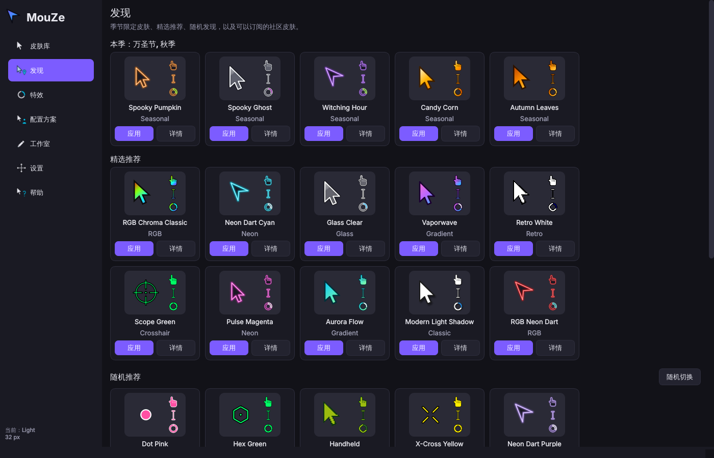

<p align="center">
  
</p>

<h1 align="center">MouZe</h1>

<p align="center">
  <b>Free, open-source custom mouse cursors, cursor effects and a cursor designer.</b><br>
  An open alternative to <i>Mouse X</i> that covers every Mouse X feature, imports your Mouse X skins and
  cursors from other platforms, and adds a lot more.
</p>


## Highlights

- **235 original built-in skins** in 10 categories: Classic, Color, Neon, RGB, Gradient, Glass, Retro, Minimal, Crosshair and Seasonal. Every skin covers all 17 Windows cursor roles, and because they are vector-drawn they stay sharp at any size from 16 to 256 px.
- **Bring your cursors with you.** MouZe can import:
  - **Mouse X** skins you subscribed to on the Steam Workshop
  - Windows `.cur`/`.ani` packs
  - Linux Xcursor themes and theme sources
  - Hyprland hyprcursor themes
  - macOS Mousecape `.cape` files
  - CSS cursor packs from websites and browser extensions
  - plain images and frame sequences
- **Discover:** seasonal picks (Spooky Halloween cursors right now), staff picks, random finds, and **community catalogs** that work like the Workshop. You subscribe to skins, they appear in your library and they update automatically, with no account needed.
- **Cursors are applied natively, with no hooks and no injection.** On Windows, MouZe writes a standard pointer scheme, which is the same thing *Mouse Properties → Pointers* does. On Linux it installs an Xcursor theme. Nothing touches other processes, so it is safe to run next to anti-cheat protected games. Your cursor also stays applied after you close MouZe.
- **Cursor effects:** trails (ribbon, comet, sparkles, bubbles, ghost cursors), click effects (ripple, burst, confetti, pulse), highlight halo, presentation spotlight, and shake-to-find-your-cursor.
- **Studio**
  - **Designer:** build a full cursor set from a pointer shape, style, colours, gradient, glow and animation, with a live preview.
  - **Pack Builder:** make a skin from your own PNG, GIF, APNG, WebP, AVIF, SVG, CUR or ANI files and click on the image to set each hotspot. It can also open and edit skins you already have, including imported Mouse X skins, and has built-in help.
- **Exports** to Windows packs (with a right-click-installable `install.inf`), Linux Xcursor themes, macOS Mousecape `.cape` files, website CSS packs, `.mouzeskin` files or a PNG preview sheet. Your skins work on other platforms too.
- **Per-skin adjustments:**
  - its own size, or the size shared by all skins
  - hue, saturation, brightness, opacity and animation speed
  - tint, greyscale, invert, extra outline and drop shadow
  - a **left-handed (mirrored)** mode
- **9 languages:** English, 简体中文, 繁體中文, Español, Français, Deutsch, Português (Brasil), Русский and 日本語.
- **Profiles** switch skin, size and effects automatically per app or game (wildcards are supported) or by time of day. **Shuffle** applies a random skin every *N* minutes.
- **Global hotkeys:** next/previous favourite, size up/down, toggle effects, locate cursor, spotlight, and a **panic restore** that brings back your original cursors.
- **Silent running, tray menu and start at login.** Cursors re-render automatically when you change monitors or display scaling. There's a one-click restart button and a built-in Help & FAQ page.
- **Try before you apply:** hover the test zones to use each cursor in place.
- **Command line** for scripting: `mouze apply "Neon Cyan" --size 48` or `mouze import-mousex`.

<p align="center"></p>

## Every Mouse X feature, and what MouZe does for it

Checked against [Mouse X's Steam page](https://store.steampowered.com/app/4255580/Mouse_X/), its update notes and its developer's website. Mouse X is closed source, so features that aren't documented publicly can't be listed here.

| Mouse X feature | In MouZe |
|---|---|
| Live, animated custom cursors on the desktop | ✅ Applied natively, so it costs no CPU while idle. An optional overlay mode draws the cursor itself, the way Mouse X does (Windows). |
| Library of skins with an in-app browser | ✅ Library (search, categories, favourites, recent) plus the **Discover** page |
| Steam Workshop: subscribe to skins, share your own | ✅ **Community catalogs**: subscribe, auto-update and unsubscribe from Discover. Publish by adding to a catalog, which anyone can host. You can also **import your existing Mouse X Workshop downloads**. |
| Remembers subscriptions even when Steam is closed | ✅ Subscriptions live in MouZe's settings, and Steam isn't needed at all |
| Discover page, including seasonal skins (e.g. "SPOOKY") | ✅ Seasonal section that follows the calendar (Halloween, winter, Valentine's…), staff picks and random picks |
| Skin editor using PNG, GIF, AVIF or SVG art | ✅ Pack Builder (plus APNG, WebP, BMP, TIFF, CUR, ANI, Xcursor) and a procedural Designer |
| Editor imports ANI and CUR files | ✅ |
| "Import for Workshop": edit an item you already published | ✅ **Open existing skin / Edit** loads any image-based skin back into the Pack Builder. Save in place or as a new skin. |
| Help section in the editor | ✅ |
| Per-skin options: size and playback speed | ✅ Plus hue, saturation, brightness, opacity, tint, outline, shadow and mirror |
| Silent running (and a toggle to turn it off) | ✅ Settings → Silent running |
| Simplified and Traditional Chinese | ✅ Plus Spanish, French, German, Brazilian Portuguese, Russian and Japanese |
| Help page with FAQ | ✅ |
| Restart button | ✅ In Settings, Help and the tray menu |
| Prompt to relaunch when the display changes | ✅ Better: MouZe re-renders cursors and overlays automatically, with no relaunch |
| No hooks or injection | ✅ |
| Low memory/CPU use | ✅ Native cursors need no running process. Effects only repaint the small area that changed. |
| Free demo, $2.99 to buy | ✅ Everything is free (MIT) |

On top of that, MouZe adds things that Mouse X's documentation does not mention:

- trails, click effects, halo and spotlight
- shake-to-find
- per-app and time-of-day profiles
- skin shuffle
- global hotkeys with a panic restore
- left-handed cursors
- Linux support
- exports to standard Windows, Linux, macOS and web formats
- a CLI



## Importing Mouse X skins and cursors from other platforms

| From | How |
|---|---|
| **Mouse X** (Steam Workshop) | Library → Import → **From Mouse X / Steam Workshop…** (or `mouze import-mousex`). MouZe finds every Steam library and lists the skins you subscribed to (`steamapps/workshop/content/4255580`). It can look up their titles online, and converts the ones you pick. *Mouse X* doesn't publish its skin format, so the importer reads the images, frame sequences, GIF/AVIF animations, CUR/ANI files and any metadata it finds. If a click point is off, fix it in the Pack Builder. Imported skins stay on your computer and still belong to their creators. |
| Other Steam cursor apps | Tick *Also scan other Steam cursor apps* in the same dialog, or use `mouze import-mousex --all-apps` |
| Windows | `.cur` / `.ani` files and packs, with or without `install.inf`, as a folder or `.zip` |
| Linux | Installed Xcursor themes (folder or `.tar.gz`) and theme **sources** (`xcursorgen` configs + PNGs, as used by most themes on GitHub) |
| Hyprland | hyprcursor themes (`manifest.hl` + `.hlc` or source folders) |
| macOS | **Mousecape** `.cape` files |
| Web / browser extensions | CSS cursor packs (`cursor: url(...) x y, pointer`), including inline `data:` images |
| Anything else | Folders of PNG/GIF/APNG/WebP/AVIF/SVG images or numbered frames such as `busy_01.png…`. Roles are guessed from file names, and hotspots come from JSON/INI metadata or are detected automatically. |

<p align="center"></p>

> **About Mouse X's skins:** the thousands of skins on Mouse X's Workshop were made by individual community members and belong to them. MouZe therefore doesn't bundle or redistribute them. It ships its own original designs, and it converts the copies *you* already downloaded, for your own use.

## Built-in library


## Install

### Windows / Linux / macOS builds
Download the latest build from the [Releases](https://github.com/AlphaMeep/MouZe-/releases) page, unzip it and run `MouZe`.
The macOS build is unsigned (right-click → **Open** the first time). On macOS, MouZe can't change the system cursor, but effects, Studio and every export work.

### From source (any platform with Python 3.10+)

```bash
git clone https://github.com/AlphaMeep/MouZe-.git
cd MouZe-
pip install .            # or: pip install ".[input]" on Linux/macOS for global hotkeys + click effects
mouze                    # starts the app
```

On Linux you may need the Qt runtime libraries, for example `sudo apt install libegl1 libxkbcommon0`.

## Using it

1. Open **Library**, pick a skin, and use the **Try it** area to test it.
2. Optionally adjust size, colours, speed, or left-handed mode. Adjustments are saved per skin.
3. Click **Apply**. Your cursor changes system-wide and stays changed even after you quit MouZe.
4. To undo, use **Settings → Restore my previous cursors** or the panic hotkey <kbd>Ctrl</kbd>+<kbd>Alt</kbd>+<kbd>R</kbd>.

| Default hotkey | Action |
|---|---|
| <kbd>Ctrl</kbd>+<kbd>Alt</kbd>+<kbd>→</kbd> / <kbd>←</kbd> | Next / previous favourite skin |
| <kbd>Ctrl</kbd>+<kbd>Alt</kbd>+<kbd>↑</kbd> / <kbd>↓</kbd> | Cursor size up / down |
| <kbd>Ctrl</kbd>+<kbd>Alt</kbd>+<kbd>E</kbd> | Toggle effects |
| <kbd>Ctrl</kbd>+<kbd>Alt</kbd>+<kbd>L</kbd> | Locate cursor |
| <kbd>Ctrl</kbd>+<kbd>Alt</kbd>+<kbd>S</kbd> | Toggle spotlight |
| <kbd>Ctrl</kbd>+<kbd>Alt</kbd>+<kbd>R</kbd> | **Restore original cursors** |
| <kbd>Ctrl</kbd>+<kbd>Alt</kbd>+<kbd>M</kbd> | Show MouZe |

All hotkeys can be changed in **Settings**.

### Command line

```bash
mouze list --category Neon                 # browse skins
mouze info "RGB Chroma Classic"
mouze apply "Gap Cross Green" --size 40    # set the system cursor
mouze restore                              # back to what you had before
mouze export "Vaporwave" -f windows -o ~/Vaporwave       # .cur/.ani + install.inf
mouze export "Vaporwave" -f xcursor -o ~/.local/share/icons/Vaporwave
mouze export "Vaporwave" -f cape -o Vaporwave.cape        # macOS Mousecape
mouze export "Vaporwave" -f css -o ~/site/cursors         # PNGs + mouze-cursors.css for websites
mouze import ~/Downloads/some-cursor-pack.zip   # also .cape, .css, hyprcursor, xcursorgen sources…
mouze import-mousex --list                 # find your Mouse X Workshop skins
mouze import-mousex --online               # import them all (looking up titles on Steam)
```

## Screenshots

| Studio Designer | Effects | Profiles | 简体中文 |
|---|---|---|---|
|  |  |  |  |

## How it works

| Platform | Changing the cursor | Effects overlay | Hotkeys |
|---|---|---|---|
| **Windows 10/11** | Writes a pointer scheme to `HKCU\Control Panel\Cursors` and calls `SystemParametersInfo(SPI_SETCURSORS)`. Multi-size `.cur`/`.ani` files keep cursors sharp on HiDPI. Your previous scheme is backed up and can be restored. | Click-through layered windows, one per monitor | `RegisterHotKey` (hook-free) |
| **Linux (X11 and most Wayland desktops)** | Generates an Xcursor theme in `~/.local/share/icons` and switches to it via GNOME, Cinnamon, MATE, KDE Plasma, XFCE, Hyprland, Sway or `xsetroot` | X11 only (Wayland doesn't allow global overlays) | `pynput` (optional) |
| **macOS** | Not possible with public APIs | ✅ | `pynput` (optional) |

There is also an experimental **overlay cursor** mode on Windows. It hides the system cursor and draws the skin on the overlay instead, which allows any size, perfectly smooth animation and tilt-while-moving. It adds about one frame of latency, so keep it off for competitive games. If MouZe crashes while this mode is on, it restores your cursor the next time it starts.

## Make and share skins

- **Designer:** pick a template, tweak it, then use **Save & apply**.
- **Pack Builder:** assign an image to each role and click to set hotspots. **Auto-fill from a folder** matches files by name (e.g. `busy.gif`, `link.png`).
- **By hand:** a skin is a folder or `.mouzeskin` zip with a `skin.json`. See [docs/SKIN_FORMAT.md](docs/SKIN_FORMAT.md).

Share a skin by exporting it as a `.mouzeskin` file, a Windows pack or an Xcursor theme. Recipients can drag the file onto the MouZe window, or use **Import → From URL…**.

To publish skins for everyone, put them in a **community catalog**: an `index.json` plus the files, hosted anywhere (GitHub works). People add the catalog in Discover and subscribe. The starter catalog lives in [`community/`](community/), and [docs/COMMUNITY.md](docs/COMMUNITY.md) explains how to host your own or contribute to this one.

## Development

```bash
pip install -e ".[dev]"
pytest                          # Qt runs offscreen, no display needed
ruff check mouze tests
python scripts/make_assets.py   # regenerate README images and icons
python scripts/i18n_strings.py  # check translations are complete
python scripts/build_community.py  # rebuild the starter community catalog
python scripts/build_site.py    # build the website into _site/ (open _site/index.html via any web server)
```

### Website

[`site/`](site/) is a static website with a gallery where visitors can **try every skin live in the browser**: clicking a skin switches the page's cursors to it, using the same files `mouze export -f css` produces. Each skin also gets a downloadable web cursor pack, and the community catalog is mirrored alongside it. `scripts/build_site.py` renders it, and the *Website* workflow publishes it to GitHub Pages on every push to `main` (one-time setup: **Settings → Pages → Source: GitHub Actions**).

The code is organised like this:

- `mouze/builtin`: vector geometry and styles for the procedural skins.
- `mouze/formats`: `.cur`/`.ani`/Xcursor readers and writers, plus pack import/export.
- `mouze/backends`: system-cursor integration for each OS.
- `mouze/overlay`: the effects overlay.
- `mouze/gui`: the Qt interface.
- `site/`: the website (built by `scripts/build_site.py`).

See [CONTRIBUTING.md](CONTRIBUTING.md).

## License

MIT. That covers the code and all built-in skins.
