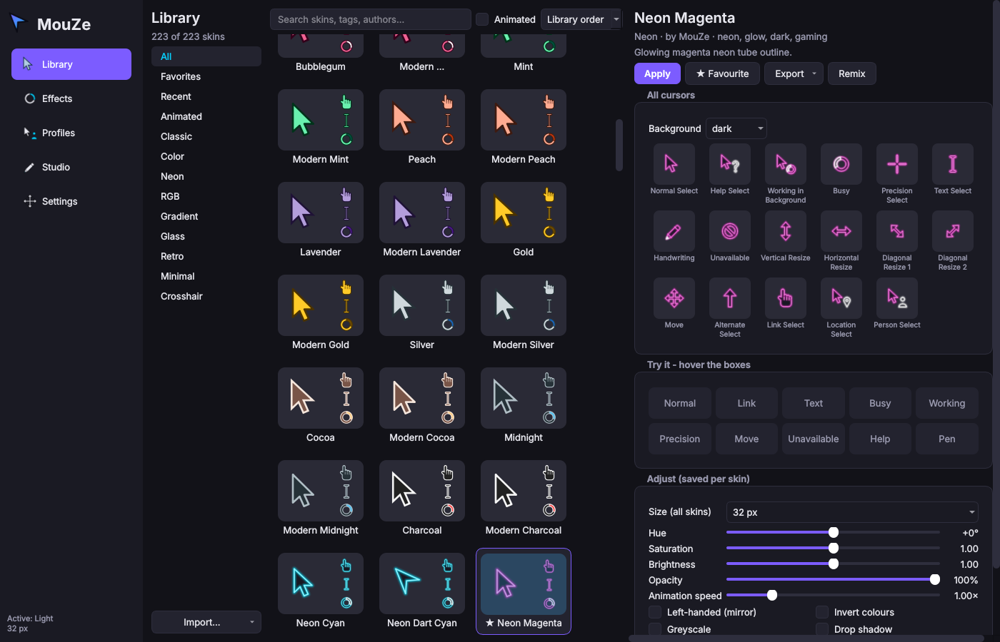
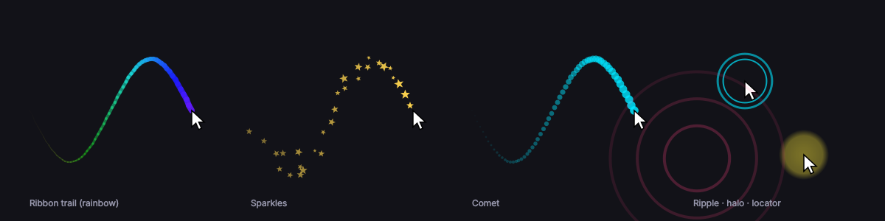
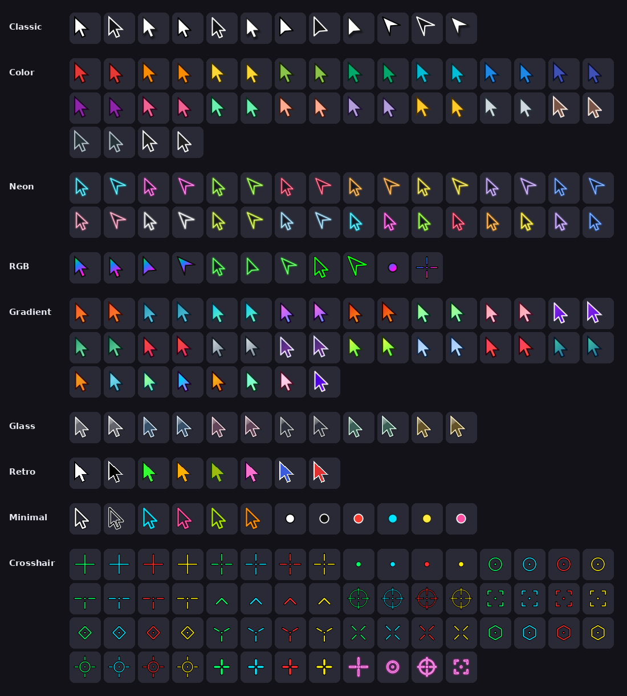
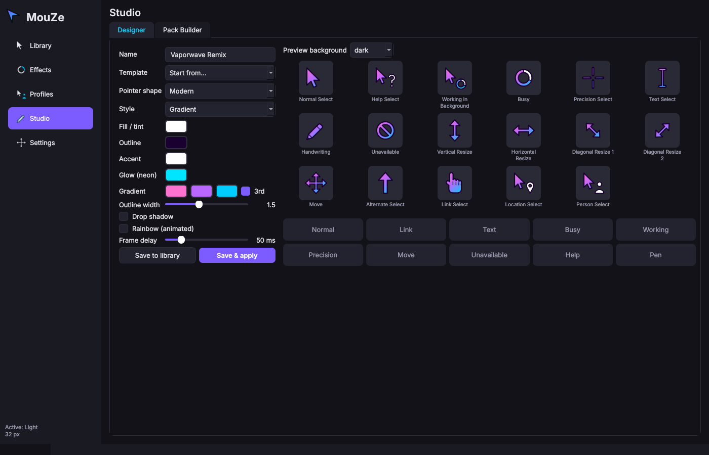
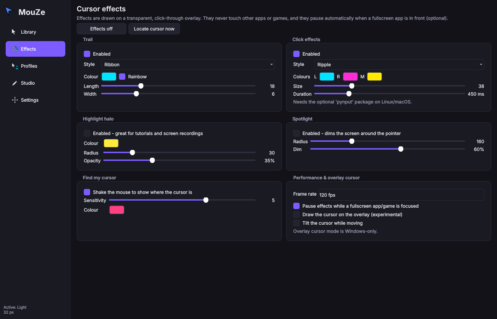
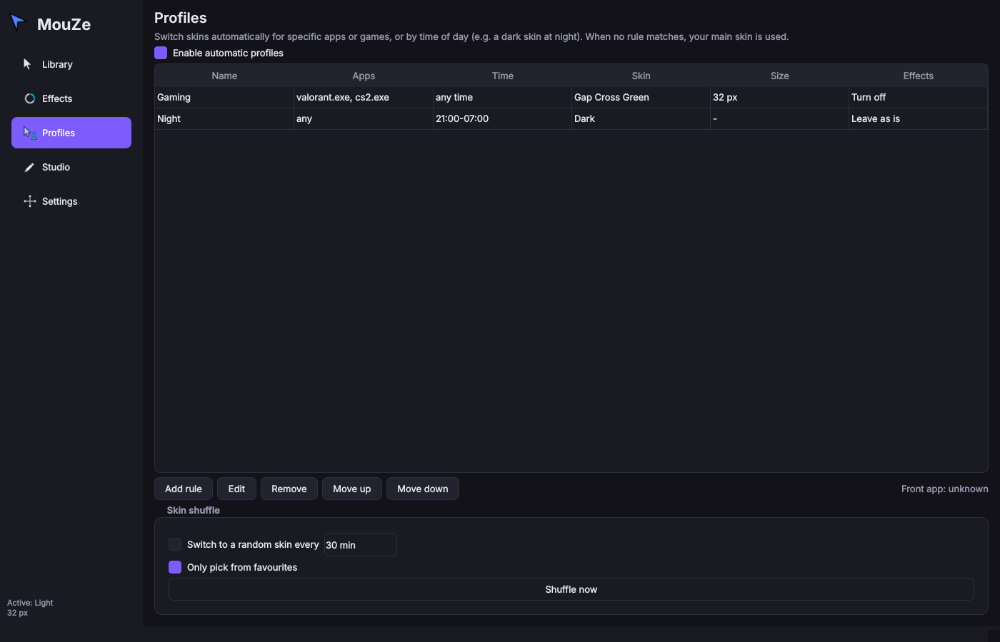

<p align="center">
  
</p>

<h1 align="center">MouZe</h1>

<p align="center">
  <b>Free, open-source custom mouse cursors, cursor effects and a cursor designer.</b><br>
  An open alternative to paid cursor tools such as <i>Mouse X</i>, with 223 built-in skins and more features.
</p>



## Highlights

- **223 original built-in skins** in 9 categories: Classic, Color, Neon, RGB, Gradient, Glass, Retro, Minimal and Crosshair. Every skin covers all 17 Windows cursor roles, and because they are vector-drawn they stay sharp at any size from 16 to 256 px.
- **Cursors are applied natively, with no hooks and no injection.** On Windows, MouZe writes a standard pointer scheme, which is the same thing *Mouse Properties → Pointers* does. On Linux it installs an Xcursor theme. Nothing touches other processes, so it is safe to run next to anti-cheat protected games. Your cursor also stays applied after you close MouZe.
- **Cursor effects:** trails (ribbon, comet, sparkles, bubbles, ghost cursors), click effects (ripple, burst, confetti, pulse), highlight halo, presentation spotlight, and shake-to-find-your-cursor.
- **Studio**
  - **Designer:** build a full cursor set from a pointer shape, style, colours, gradient, glow and animation, with a live preview.
  - **Pack Builder:** make a skin from your own PNG, GIF, APNG, WebP, AVIF, SVG, CUR or ANI files, and click on the image to set each hotspot.
- **Imports almost anything:** Windows cursor packs (`.cur`/`.ani` + `install.inf`, as a folder or `.zip`), Linux Xcursor themes (as a folder or `.tar.gz`), `.mouzeskin` files, loose images, and direct download links.
- **Exports** to a Windows pack with a right-click-installable `install.inf`, a Linux Xcursor theme, a `.mouzeskin` file or a PNG preview sheet. You can share your skins with people who don't use MouZe.
- **Per-skin adjustments:** size, hue, saturation, brightness, opacity, animation speed, tint, greyscale, invert, extra outline, drop shadow, and a **left-handed (mirrored)** mode.
- **Profiles:** switch skin, size and effects automatically per app or game (wildcards are supported) or by time of day.
- **Shuffle:** apply a random skin or favourite every *N* minutes.
- **Global hotkeys:** next/previous favourite, size up/down, toggle effects, locate cursor, spotlight, and a **panic restore** that brings back your original cursors.
- **Try before you apply:** hover the test zones to use each cursor in place.
- **System tray** with favourites, recent skins and quick toggles. Starts at login if you want.
- **Fullscreen auto-pause** stops effects while a game or video is fullscreen.
- **Command line** for scripting: `mouze apply "Neon Cyan" --size 48`.

<p align="center"></p>

## MouZe vs Mouse X

The Mouse X column below is based on what [its Steam page](https://store.steampowered.com/app/4255580/Mouse_X/) and its developer's website describe. "Not listed" means the feature is not mentioned there, not that it is definitely missing.

| | **MouZe** | Mouse X |
|---|---|---|
| Price | **Free, MIT licensed** | Paid (free demo) |
| Source code | **Open** | Closed |
| Platforms | **Windows and Linux** (macOS: effects only) | Windows |
| Hook/injection-free | ✅ | ✅ |
| Built-in skins | **223 original, vector-based** | Community Workshop library |
| Skin editor | ✅ procedural Designer + image Pack Builder | ✅ image-based editor |
| Image formats | PNG, GIF, APNG, WebP, AVIF, SVG, CUR, ANI, Xcursor | PNG, GIF, AVIF, SVG |
| Imports existing Windows packs / Linux themes | ✅ | Not listed |
| Exports to standard `.cur`/`.ani`/`install.inf` and Xcursor | ✅ | Not listed |
| Size and animation-speed settings | ✅ | ✅ |
| Hue, saturation, brightness, opacity, tint, outline, shadow | ✅ | Not listed |
| Left-handed (mirrored) cursors | ✅ | Not listed |
| Trails, click effects, halo, spotlight | ✅ | Not listed |
| Shake to find cursor | ✅ | Not listed |
| Per-app and time-of-day profiles | ✅ | Not listed |
| Global hotkeys and panic restore | ✅ | Not listed |
| Skin shuffle | ✅ | Not listed |
| CLI | ✅ | Not listed |
| Skin sharing | `.mouzeskin` files, standard packs, URL import | Steam Workshop |

> **About Mouse X's skins:** the thousands of skins on Mouse X's Workshop were made by individual community members and belong to them, so MouZe does not copy or bundle them. MouZe ships its own original designs that cover the same popular categories (neon, RGB, glass, crosshair, retro, professional). If you already own cursor packs, MouZe can **import** them directly.

## Built-in library



## Install

### Windows / Linux builds
Download the latest build from the [Releases](https://github.com/AlphaMeep/MouZe-/releases) page, unzip it and run `MouZe`.

### From source (any platform with Python 3.10+)

```bash
git clone https://github.com/AlphaMeep/MouZe-.git
cd MouZe-
pip install .            # or: pip install ".[input]" on Linux/macOS for global hotkeys + click effects
mouze                    # starts the app
```

On Linux you may need the Qt runtime libraries, for example `sudo apt install libegl1 libxkbcommon0`.

## Using it

1. Open **Library**, pick a skin, and use the **Try it** area to test it.
2. Optionally adjust size, colours, speed, or left-handed mode. Adjustments are saved per skin.
3. Click **Apply**. Your cursor changes system-wide and stays changed even after you quit MouZe.
4. To undo, use **Settings → Restore my previous cursors** or the panic hotkey <kbd>Ctrl</kbd>+<kbd>Alt</kbd>+<kbd>R</kbd>.

| Default hotkey | Action |
|---|---|
| <kbd>Ctrl</kbd>+<kbd>Alt</kbd>+<kbd>→</kbd> / <kbd>←</kbd> | Next / previous favourite skin |
| <kbd>Ctrl</kbd>+<kbd>Alt</kbd>+<kbd>↑</kbd> / <kbd>↓</kbd> | Cursor size up / down |
| <kbd>Ctrl</kbd>+<kbd>Alt</kbd>+<kbd>E</kbd> | Toggle effects |
| <kbd>Ctrl</kbd>+<kbd>Alt</kbd>+<kbd>L</kbd> | Locate cursor |
| <kbd>Ctrl</kbd>+<kbd>Alt</kbd>+<kbd>S</kbd> | Toggle spotlight |
| <kbd>Ctrl</kbd>+<kbd>Alt</kbd>+<kbd>R</kbd> | **Restore original cursors** |
| <kbd>Ctrl</kbd>+<kbd>Alt</kbd>+<kbd>M</kbd> | Show MouZe |

All hotkeys can be changed in **Settings**.

### Command line

```bash
mouze list --category Neon                 # browse skins
mouze info "RGB Chroma Classic"
mouze apply "Gap Cross Green" --size 40    # set the system cursor
mouze restore                              # back to what you had before
mouze export "Vaporwave" -f windows -o ~/Vaporwave       # .cur/.ani + install.inf
mouze export "Vaporwave" -f xcursor -o ~/.local/share/icons/Vaporwave
mouze import ~/Downloads/some-cursor-pack.zip
```

## Screenshots

| Studio Designer | Effects | Profiles |
|---|---|---|
|  |  |  |

## How it works

| Platform | Changing the cursor | Effects overlay | Hotkeys |
|---|---|---|---|
| **Windows 10/11** | Writes a pointer scheme to `HKCU\Control Panel\Cursors` and calls `SystemParametersInfo(SPI_SETCURSORS)`. Multi-size `.cur`/`.ani` files keep cursors sharp on HiDPI. Your previous scheme is backed up and can be restored. | Click-through layered windows, one per monitor | `RegisterHotKey` (hook-free) |
| **Linux (X11 and most Wayland desktops)** | Generates an Xcursor theme in `~/.local/share/icons` and switches to it via GNOME, Cinnamon, MATE, KDE Plasma, XFCE, Hyprland, Sway or `xsetroot` | X11 only (Wayland doesn't allow global overlays) | `pynput` (optional) |
| **macOS** | Not possible with public APIs | ✅ | `pynput` (optional) |

There is also an experimental **overlay cursor** mode on Windows. It hides the system cursor and draws the skin on the overlay instead, which allows any size, perfectly smooth animation and tilt-while-moving. It adds about one frame of latency, so keep it off for competitive games. If MouZe crashes while this mode is on, it restores your cursor the next time it starts.

## Make and share skins

- **Designer:** pick a template, tweak it, then use **Save & apply**.
- **Pack Builder:** assign an image to each role and click to set hotspots. **Auto-fill from a folder** matches files by name (e.g. `busy.gif`, `link.png`).
- **By hand:** a skin is a folder or `.mouzeskin` zip with a `skin.json`. See [docs/SKIN_FORMAT.md](docs/SKIN_FORMAT.md).

Share a skin by exporting it as a `.mouzeskin` file, a Windows pack or an Xcursor theme. Recipients can drag the file onto the MouZe window, or use **Import → From URL…**.

## Development

```bash
pip install -e ".[dev]"
pytest                # Qt runs offscreen, no display needed
ruff check mouze tests
python scripts/make_assets.py   # regenerate README images and icons
```

The code is organised like this:

- `mouze/builtin`: vector geometry and styles for the procedural skins.
- `mouze/formats`: `.cur`/`.ani`/Xcursor readers and writers, plus pack import/export.
- `mouze/backends`: system-cursor integration for each OS.
- `mouze/overlay`: the effects overlay.
- `mouze/gui`: the Qt interface.

See [CONTRIBUTING.md](CONTRIBUTING.md).

## License

MIT. That covers the code and all built-in skins.
